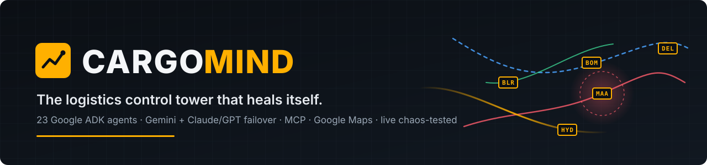
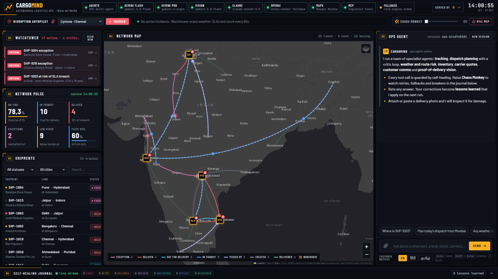
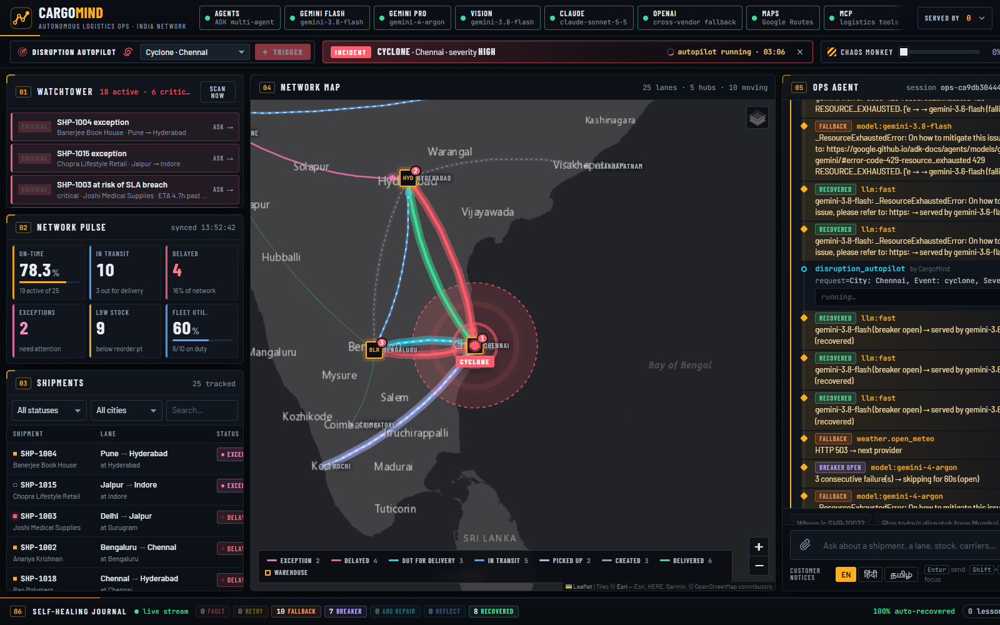
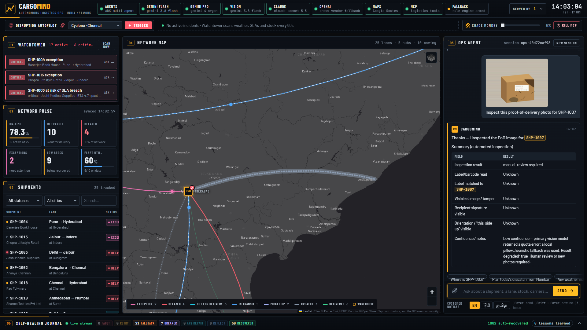
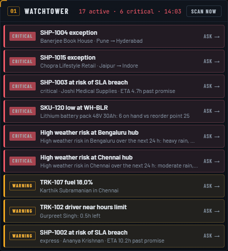
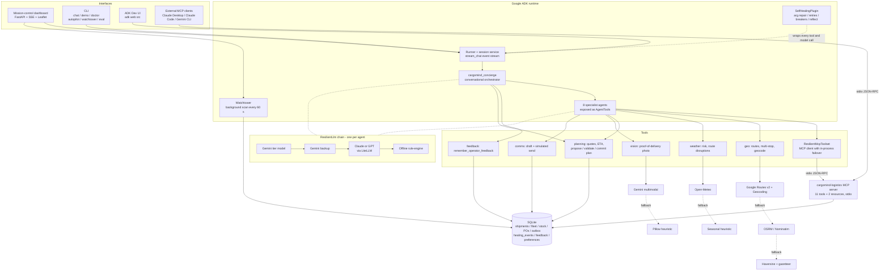
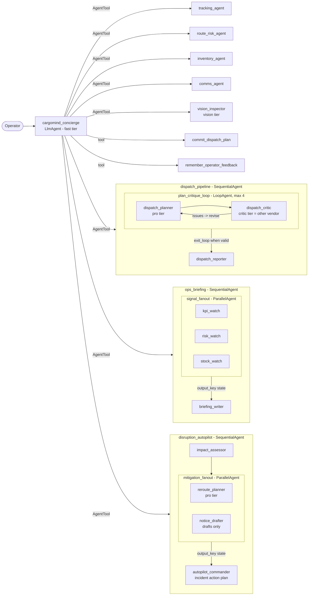

<div align="center">



# CargoMind

**A self-healing, multi-model, multi-agent logistics control tower.**
Built on Google ADK, Gemini, Google Maps and MCP. Ask it about any shipment, lane, truck or SKU in an India-wide 3PL network. It plans, checks its own work and keeps answering when models, APIs or servers fail.

### ▶ [Open the live demo](https://cargomind-lilac.vercel.app) · [Run it locally in 60 s](#quickstart) · [Criteria → proof](#how-cargomind-meets-the-judging-criteria) · [See it in action](#see-it-in-action)

[](https://github.com/Anandb71/cargomind/actions/workflows/ci.yml)


[](LICENSE)

[Quickstart](#quickstart) · [Criteria map](#how-cargomind-meets-the-judging-criteria) · [Architecture](#architecture) · [Demo script](#demo-script) · [Self-healing](#self-healing-deep-dive) · [Feedback loops](#feedback-loops-deep-dive) · [Deploy](#deploy-to-google-cloud-run)

</div>


<p align="center"><i>Mission control, running live: Watchtower alerts (left), network pulse KPIs, the shipment map with status-coloured lanes, the conversational ops agent (right) and the self-healing journal (bottom).</i></p>

| **23** | **3 vendors** | **11 + 2** | **18 / 18** | **0** |
|:---:|:---:|:---:|:---:|:---:|
| Google ADK agents using `AgentTool`, `Sequential`, `Parallel` and `Loop` patterns | Gemini → Claude / GPT → offline engine, failover per request | MCP tools + resources in our own server | eval scenarios pass, **also under 30% injected chaos** | API keys needed to run it |

> **Self-healing, seen live.** One real request from our live runs, straight from the healing journal: `gemini-3.8-flash` → 429 RESOURCE_EXHAUSTED · `gemini-3.6-flash` → 429 · `anthropic/claude-sonnet-5-5` → error · **served by `openai/gpt-5-mini` — recovered**. The operator just got their answer. Across those runs the journal recorded 19 automatic cross-vendor model recoveries.

---

**Judge fast path:** [90-second demo](docs/DEMO_SCRIPT.md) · [criterion-by-criterion evidence](docs/JUDGING.md) · [reproducible eval report](docs/EVAL_REPORT.md). Verified: **100 tests pass**, **18/18 offline scenarios succeed**, routing **F1 0.974**. The timed demo uses the offline engine; live provider usage is visible in the trace.

**Resilience evidence:** [30% chaos eval](docs/EVAL_CHAOS_REPORT.md) also completed **18/18 scenarios**, with **14 injected faults**, **12 retries** and **12 recorded recoveries**. Both eval runs use the offline model and in-process MCP; CI separately exercises stdio MCP and Docker.

## Contents

- [See it in action](#see-it-in-action)
- [The 30-second pitch](#the-30-second-pitch)
- [How CargoMind meets the judging criteria](#how-cargomind-meets-the-judging-criteria)
- [Architecture](#architecture)
- [Feature tour](#feature-tour)
- [Quickstart](#quickstart)
- [Full setup (Windows, macOS, Linux)](#full-setup-windows-macos-linux)
- [Getting the API keys](#getting-the-api-keys)
- [Configuration reference](#configuration-reference)
- [CLI reference](#cli-reference)
- [Mission-control dashboard](#mission-control-dashboard)
- [ADK Dev UI](#adk-dev-ui)
- [MCP server](#mcp-server)
- [Demo script](#demo-script)
- [Self-healing deep dive](#self-healing-deep-dive)
- [Feedback loops deep dive](#feedback-loops-deep-dive)
- [Disruption Autopilot and Watchtower](#disruption-autopilot-and-watchtower)
- [Evaluation](#evaluation)
- [Project structure](#project-structure)
- [Testing and CI](#testing-and-ci)
- [Docker](#docker)
- [Deploy to Google Cloud Run](#deploy-to-google-cloud-run)
- [Troubleshooting and FAQ](#troubleshooting-and-faq)
- [Roadmap](#roadmap)
- [Team](#team)
- [License](#license)

More depth: [docs/ARCHITECTURE.md](docs/ARCHITECTURE.md) (sequence diagrams), [docs/JUDGING.md](docs/JUDGING.md) (criteria checklist with file links), [docs/DEMO_SCRIPT.md](docs/DEMO_SCRIPT.md) (3-minute live demo run-sheet).

---

## See it in action

**Disruption Autopilot: one sentence starts a multi-agent incident response.** *"Cyclone alert in Chennai, severity high: run disruption autopilot."* The map draws the impact zone around Chennai and lights up every exposed lane. Then `impact_assessor` hands off to a `ParallelAgent` (reroute planner + notice drafter), and `autopilot_commander` writes the incident action plan for the operator to approve. In this capture the journal on the right shows Gemini hitting its quota and the run continuing on the next model.



<table>
<tr>
<td width="50%" valign="top">

**Multimodal proof-of-delivery inspection that knows when not to guess.** Attach a delivery photo and Gemini vision returns `damage_detected`, severity, findings and the next action. In this capture Gemini vision was over quota, so the local Pillow fallback answered instead: it marked the result `degraded`, explained why and asked for human review rather than inventing a verdict.



</td>
<td width="50%" valign="top">

**Watchtower acts before you ask.** It scans SLAs, exceptions, stock, fleet and hub weather every 60 s. Each alert is a one-click question to the agent; weather alerts launch the autopilot.



</td>
</tr>
</table>

---

## The 30-second pitch

**The problem.** A logistics control tower runs on a dozen screens: a TMS for shipments, a WMS for stock, maps for routes, weather for risk, spreadsheets for dispatch, WhatsApp for customers. Most AI assistants for this job stop working the moment an API rate-limits, a model returns a 429 or a backend crashes. In operations that is the moment you need them.

**CargoMind** puts the whole control tower behind one conversation:

- **One concierge, many specialists.** A conversational Gemini agent sends each request to 8 specialist agents: tracking, routes and risk, inventory, dispatch, customer comms, photo inspection, the ops briefing and the Disruption Autopilot. The graph has 23 ADK agents in total and uses every ADK workflow pattern: `LlmAgent` + `AgentTool`, `SequentialAgent`, `ParallelAgent` and `LoopAgent`.
- **Multi-model by design.** Conversation, planning and vision tiers prefer Gemini models. The independent dispatch critic prefers Claude or GPT. The trace records which provider actually ran after any fallback. A deterministic offline rule-engine is the last link of every model chain.
- **It checks its own work.** The dispatch planner and an independent critic run in a feedback loop. The critic checks truck capacity, driver hours, cold-chain and hazmat handling, SLA and weather. The planner revises until the plan is valid. Nothing is written to the database until you say *"commit the plan"*.
- **It acts before you ask.** The **Watchtower** scans the network every 60 s for SLA breach risk, exceptions, low stock, fleet problems and hub weather, and turns each alert into a one-click question. For a cyclone, flood, strike or closure, the **Disruption Autopilot** assesses the impact, plans reroutes and drafts customer notices in parallel, then hands the operator an incident action plan to approve.
- **It learns from the operator.** Thumbs up or down, comments and *"remember: always..."* are turned into lessons. Those lessons are added to the agent's instructions on every turn.
- **It heals itself.** The system has five layers of self-healing:
  - model failover across vendors
  - tool-argument repair, retries and circuit breakers
  - API fallbacks: Google Maps → OpenStreetMap → offline math
  - MCP-server failover
  - a Chaos Monkey slider so you can break things live and watch it recover

  Every fault and recovery is written to a live healing journal.
- **Runs with zero keys.** `git clone` → `uv sync` → `uv run cargomind web` gives you a working system with no API keys at all. Add keys to switch on Gemini, Claude/OpenAI and Google Maps.

---

## How CargoMind meets the judging criteria

| Criterion | How CargoMind meets it | Where to look | Verify in under a minute |
|---|---|---|---|
| **Tool set: Agent SDK** | Built on **Google ADK 2.12**. It uses `LlmAgent`, `AgentTool`, `SequentialAgent`, `ParallelAgent`, `LoopAgent`, `exit_loop`, `output_key` state passing, `App` + `BasePlugin`, `Runner` + sessions, `McpToolset` and a custom `BaseLlm` | [`agent.py`](src/cargomind/agent.py), [`runtime.py`](src/cargomind/runtime.py), [`healing/plugin.py`](src/cargomind/healing/plugin.py) | `uv run adk web src`, then pick **cargomind** |
| **Tool set: Google products** | **Gemini** in 4 roles (fast, pro, backup, multimodal vision). **Google Maps Routes API v2** and **Geocoding API**. **Cloud Run**, **Cloud Build** and **Secret Manager** for deployment. The **ADK Dev UI**. **Gemini CLI** as an MCP client | [`config.py`](src/cargomind/config.py), [`tools/geo.py`](src/cargomind/tools/geo.py), [`tools/vision.py`](src/cargomind/tools/vision.py), [`deploy/cloudrun.sh`](deploy/cloudrun.sh) | `uv run cargomind doctor` lists the live providers |
| **"No half-baked information: A–Z instructions"** | This README covers a zero-key quickstart, setup for each OS, every API key step by step, every env var and command, the dashboard, ADK UI, MCP, Docker, Cloud Run and troubleshooting. `cargomind doctor` runs a self-check | this file, [`docs/`](docs) | Follow [Quickstart](#quickstart) on a clean machine |
| **Multi-model agents** | 4 model tiers across **Gemini + Claude/OpenAI + an offline engine**. When a Claude or OpenAI key is set, the critic deliberately runs on a **different vendor** from the planner. Images go to Gemini multimodal. Each answer is tagged with the model that served it (`served_by`) | [`healing/resilient_llm.py`](src/cargomind/healing/resilient_llm.py) (`build_model`), [`agent.py`](src/cargomind/agent.py) | Dashboard trace and CLI show `[served_by]` on every answer |
| **Conversational agents** | The `cargomind_concierge` agent keeps sessions and remembers the conversation (*"commit the plan"* refers to the plan from 3 turns ago). It asks clarifying questions and handles requests that span several domains in one turn. Available in the CLI, the dashboard and the ADK UI | [`agent.py`](src/cargomind/agent.py) (`root_agent`), [`runtime.py`](src/cargomind/runtime.py) | `uv run cargomind chat` |
| **API calls** | Google Routes v2 (`computeRoutes`, waypoint optimisation), Google Geocoding, Open-Meteo forecasts, OSRM and Nominatim fallbacks, Gemini vision, and Anthropic/OpenAI through LiteLLM. CargoMind also exposes its own REST + SSE API | [`tools/`](src/cargomind/tools), [`web/server.py`](src/cargomind/web/server.py) | Ask *"Any weather risk on Mumbai → Pune today?"* |
| **MCP integration** | CargoMind ships its own **MCP server** (`cargomind-logistics`, 11 tools + 2 resources over stdio). Its own agents use it through ADK `McpToolset`, wrapped in a self-healing `ResilientMcpToolset`. The same server plugs into Claude Desktop, Claude Code, Gemini CLI or the MCP Inspector | [`mcp_server/server.py`](src/cargomind/mcp_server/server.py), [`mcp_tools.py`](src/cargomind/mcp_tools.py), [`deploy/claude_desktop_config.example.json`](deploy/claude_desktop_config.example.json) | `uv run cargomind mcp` (see [MCP server](#mcp-server)) |
| **Feedback loop** | **(1)** Planner and critic run in a `LoopAgent` until the plan is valid. **(2)** Operator thumbs and comments, plus `remember_operator_feedback`, become lessons that are added to the instruction on every turn. **(3)** Human-in-the-loop commit. **(4)** Reflect-and-retry hints let the LLM correct its own tool calls | [`agent.py`](src/cargomind/agent.py), [`tools/planning.py`](src/cargomind/tools/planning.py), [`feedback/store.py`](src/cargomind/feedback/store.py) | *"Plan today's dispatch from Mumbai"*, then a thumbs-down with a comment |
| **Self-healing agents** | **5 layers:** a resilient model chain with rollback, the `SelfHealingPlugin` (argument repair, retries, breakers, reflection), API fallback chains, MCP failover, and Chaos Monkey + a healing journal | [`healing/`](src/cargomind/healing), [`mcp_tools.py`](src/cargomind/mcp_tools.py) | Set the dashboard Chaos slider to 30% and keep chatting |
| **Submission: GitHub repo + README** | MIT-licensed repo with CI (lint, tests, offline end-to-end demo under chaos, Docker build), a Dockerfile and a one-command Cloud Run deploy | [`.github/workflows/ci.yml`](.github/workflows/ci.yml), [`Dockerfile`](Dockerfile) | CI badge at the top |

A per-criterion checklist with file and symbol pointers is in [docs/JUDGING.md](docs/JUDGING.md).

---

## Architecture

### System view



### Agent graph



### Model chain (one per agent, built by `build_model(tier)`)

| Tier | Used by | Chain, tried in order (links without a key are left out) |
|---|---|---|
| `fast` | concierge, tracking, route/risk, inventory, comms, reporter, watchers, briefing writer, impact assessor, notice drafter, autopilot commander | `gemini-3.8-flash` → `gemini-2.5-flash` → Claude **or** GPT → `offline/rule-engine` |
| `pro` | dispatch planner, autopilot reroute planner | `gemini-4-argon` → `gemini-2.5-flash` → Claude **or** GPT → `offline/rule-engine` |
| `critic` | dispatch critic | **Claude or GPT first** (independent vendor) → `gemini-4-argon` → `gemini-2.5-flash` → `offline/rule-engine` |
| `vision` | vision inspector | `CARGOMIND_GEMINI_VISION` (default: the fast model) → `gemini-2.5-flash` → Claude **or** GPT → `offline/rule-engine` |

The second vendor is **Claude** (`anthropic/claude-sonnet-5-5`) when `ANTHROPIC_API_KEY` is set. Otherwise it is **GPT** (`openai/gpt-5-mini`) when `OPENAI_API_KEY` is set. Both run through LiteLLM. Every model id can be overridden: see [Configuration reference](#configuration-reference).

Sequence diagrams for a dispatch request and a self-healing fallback are in [docs/ARCHITECTURE.md](docs/ARCHITECTURE.md).

---

## Feature tour

| Agent | ADK pattern | Model tier | What it does | Tools |
|---|---|---|---|---|
| `cargomind_concierge` | `LlmAgent` that orchestrates `AgentTool`s | fast | Conversational front door. Understands the goal, calls one or more specialists in a single turn, asks clarifying questions and applies learned lessons | 8 specialist AgentTools, `commit_dispatch_plan`, `remember_operator_feedback` |
| `tracking_agent` | `LlmAgent` | fast | Status, location, history, ETA and SLA risk. Updates status only when asked | MCP: `track_shipment`, `list_shipments`, `shipment_history`, `update_shipment_status`. Native: `estimate_eta` |
| `route_risk_agent` | `LlmAgent` | fast | Road distance and time, multi-stop optimisation, weather and disruption risk, carrier quotes | `get_route`, `optimize_multi_stop_route`, `geocode`, `get_weather_risk`, `check_route_disruptions`, `quote_carriers` |
| `inventory_agent` | `LlmAgent` | fast | Stock levels, low-stock alerts, reorders (POs only when asked), warehouse info | MCP: `check_inventory`, `create_reorder`, `list_warehouses` |
| `dispatch_pipeline` | `SequentialAgent`[`LoopAgent`[planner, critic], reporter] | pro + critic + fast | Assigns pending shipments to own-fleet trucks. An independent critic checks capacity, driver hours, cold chain, hazmat, SLA, weather and duplicates. The planner revises (weather deferrals, driver swaps, team drivers, carrier hand-offs, corridor splits) until the plan is valid, then a report is written | `propose_dispatch_plan`, `validate_dispatch_plan`, `exit_loop` |
| `comms_agent` | `LlmAgent` | fast | Empathetic, specific delay or delivery notices (email, SMS, WhatsApp). Sends only after approval, to a simulated outbox | `draft_customer_notification`, `send_notification`, MCP `track_shipment` |
| `vision_inspector` | `LlmAgent` | vision | Proof-of-delivery photo inspection: damage, severity, findings, recommended action | `inspect_delivery_photo` (Gemini multimodal, JSON output) |
| `ops_briefing` | `SequentialAgent`[`ParallelAgent`[3 watchers], writer] | fast | Morning briefing: KPIs, weather at 6 hubs and low stock are gathered in parallel, then written up as Headline, Risks and Actions | MCP `get_kpis`, `hub_weather_sweep`, MCP `check_inventory` |
| `disruption_autopilot` | `SequentialAgent`[impact_assessor, `ParallelAgent`[reroute_planner, notice_drafter], autopilot_commander] | fast + pro | City-level disruption (cyclone, flood, strike, bandh, closure, landslide): finds exposed shipments, vehicles and warehouses, proposes reroutes/holds via an alternate hub, drafts customer notices (never sends) and writes an incident action plan. Nothing executes until the operator approves | `assess_disruption_impact`, `propose_disruption_reroutes`, `draft_disruption_notices` |

**The seeded network.** On first run CargoMind creates `data/cargomind.db` with a deterministic India-wide network. It contains 25 shipments (`SHP-1001`…`SHP-1025`, with real-world problems such as checkpost holds, monsoon delays, crushed cartons and hazmat), 5 warehouses (`WH-BOM`, `WH-DEL`, `WH-BLR`, `WH-MAA`, `WH-HYD`), 20 SKUs (some below their reorder point), 10 trucks (`TRK-101`…`TRK-110`, including a cold-chain reefer), 5 carriers (`CR-01`…`CR-05`) and a 20-city gazetteer. The gazetteer knows aliases such as *Bangalore*, *Bombay*, *Madras* and *Gurgaon*, and IATA-style codes such as `BLR` and `BOM`.

---

## Quickstart

Works on Windows, macOS and Linux **with zero API keys**. You need [Git](https://git-scm.com/downloads) and [uv](https://docs.astral.sh/uv/getting-started/installation/). uv installs Python 3.12 for you if you don't have it.

```bash
git clone https://github.com/Anandb71/cargomind
cd cargomind
uv sync
cp .env.example .env          # Windows: copy .env.example .env
uv run cargomind web          # open http://localhost:8080
```

Then try `uv run cargomind doctor` (self-check), `uv run cargomind demo` (scripted 8-step scenario) or `uv run cargomind chat` (terminal chat).

> With no keys, every answer comes from the offline rule-engine and the free or offline API fallbacks. The answers are structured and correct but templated. Add a free Gemini key to `.env` ([2 minutes](#1-gemini-api-key-the-brain)) to get the full multi-model experience.

---

## Full setup (Windows, macOS, Linux)

### Prerequisites

| Need | Why | Install |
|---|---|---|
| Git | clone the repo | https://git-scm.com/downloads (or use GitHub's **Code → Download ZIP**) |
| uv | Python + dependency manager (reads `uv.lock`, installs Python 3.12 automatically) | see below |
| Internet on first run | download dependencies; live APIs are optional | – |
| *(optional)* Docker | container run | https://docs.docker.com/get-docker/ |
| *(optional)* Google Cloud SDK | Cloud Run deploy | https://cloud.google.com/sdk/docs/install |
| *(optional)* Node.js 18+ | MCP Inspector only | https://nodejs.org |

### Windows 10/11 (PowerShell)

```powershell
# 1. Install uv, then CLOSE and REOPEN the terminal so `uv` is on PATH
powershell -ExecutionPolicy ByPass -c "irm https://astral.sh/uv/install.ps1 | iex"

# 2. Get the code (two separate lines: Windows PowerShell 5.1 has no `&&`)
git clone https://github.com/Anandb71/cargomind
cd cargomind

# 3. Install Python 3.12 + all dependencies into .venv
uv sync

# 4. Create your settings file (all keys optional)
copy .env.example .env
notepad .env

# 5. Check, then run
uv run cargomind doctor
uv run cargomind web
```

Open http://localhost:8080. If you hit "path too long" errors or garbled characters, see [Troubleshooting](#troubleshooting-and-faq).

### macOS

```bash
curl -LsSf https://astral.sh/uv/install.sh | sh     # or: brew install uv
exec $SHELL -l                                      # reload PATH
git clone https://github.com/Anandb71/cargomind && cd cargomind
uv sync
cp .env.example .env && open -e .env
uv run cargomind doctor
uv run cargomind web                                # http://localhost:8080
```

### Linux

```bash
curl -LsSf https://astral.sh/uv/install.sh | sh
source "$HOME/.local/bin/env" 2>/dev/null || export PATH="$HOME/.local/bin:$PATH"
git clone https://github.com/Anandb71/cargomind && cd cargomind
uv sync
cp .env.example .env && ${EDITOR:-nano} .env
uv run cargomind doctor
uv run cargomind web                                # http://localhost:8080
```

### Verify the install

`uv run cargomind doctor` prints which providers are live, the configured model ids, live KPIs from the seeded database, and a smoke-test answer to *"Where is SHP-1003?"*. The first line tells you the mode:

```text
CargoMind | live: none | offline rule-engine fallback: on                       <- zero keys
CargoMind | live: gemini, claude, google_maps | offline rule-engine fallback: on <- keys picked up
```

---

## Getting the API keys

**Every key is optional.** Put keys in `.env` at the repo root. Empty values and placeholders that start with `PASTE_`, `YOUR_` or `<` are ignored. Environment variables already set in your shell take precedence over `.env`. After changing `.env`, restart the command and re-run `uv run cargomind doctor`.

### What each key unlocks

| You set | Conversation and planning | Dispatch critic | Routes and geocoding | Weather | Photo inspection |
|---|---|---|---|---|---|
| *(nothing)* | offline rule-engine | offline rule-engine | OSRM / Nominatim (free, no key) → haversine | Open-Meteo (free, no key) → seasonal heuristic | Pillow heuristic |
| `GOOGLE_API_KEY` | **Gemini** fast / pro + backup | Gemini Pro | same as above | same | **Gemini multimodal** |
| + `ANTHROPIC_API_KEY` **or** `OPENAI_API_KEY` | + cross-vendor failover | **Claude / GPT** (independent vendor) | same | same | same |
| + `GOOGLE_MAPS_API_KEY` | – | – | **Google Routes API v2 + Geocoding** | same | same |
| `CARGOMIND_OFFLINE=1` | forces offline everywhere (no network at all) | offline | gazetteer + haversine | seasonal heuristic | Pillow heuristic |

### 1. Gemini API key (the brain)

1. Open **https://aistudio.google.com/apikey** and sign in with a Google account.
2. Click **Create API key**. Pick an existing Google Cloud project or let AI Studio create one.
3. Copy the key and paste it into `.env`:
   ```dotenv
   GOOGLE_API_KEY=AIza...your-key...
   ```
4. Run `uv run cargomind doctor`. The first line should now include `gemini`.

The free tier has per-minute limits. When you hit one, Gemini returns HTTP 429. CargoMind retries, then fails over to the backup Gemini model, then to the second vendor, then to the offline engine, automatically (see [Self-healing](#self-healing-deep-dive)).

<details>
<summary>Using Vertex AI instead of an AI Studio key</summary>

```dotenv
GOOGLE_GENAI_USE_VERTEXAI=true
GOOGLE_CLOUD_PROJECT=your-project-id
GOOGLE_CLOUD_LOCATION=us-central1
```
Then authenticate once with `gcloud auth application-default login`. Enable the Vertex AI API on the project, and check that the model ids you configure are available in that location.
</details>

### 2. Google Maps API key (Routes API + Geocoding API)

1. Open **https://console.cloud.google.com/** and select (or create) a project. Google Maps Platform requires a **billing account** on the project. It includes a monthly free usage allowance; check current pricing on the Maps Platform site.
2. Go to **APIs & Services → Library**. Search for **Routes API** and click **Enable**. Then search for **Geocoding API** and click **Enable**. CargoMind calls the Routes API v2 endpoint `routes.googleapis.com/directions/v2:computeRoutes`, not the legacy Directions API.
3. Open **https://console.cloud.google.com/google/maps-apis/credentials** and choose **Create credentials → API key**.
4. Recommended: click the key, open **API restrictions**, choose **Restrict key** and select **Routes API** and **Geocoding API**.
5. Paste it into `.env`:
   ```dotenv
   GOOGLE_MAPS_API_KEY=AIza...your-maps-key...
   ```
6. Run `uv run cargomind doctor`. The first line should now include `google_maps`. Route answers now show `source: google_routes`. Before this they showed `osrm` or `haversine` with `degraded: true`.

### 3. Second-vendor model: Claude **or** OpenAI (pick one)

**Anthropic Claude** (preferred when both are set):
1. Open **https://console.anthropic.com/settings/keys**. Add credits under Billing if the account is new.
2. Click **Create Key**, name it `cargomind` and copy it.
3. Add `ANTHROPIC_API_KEY=sk-ant-...` to `.env`.

**OpenAI:**
1. Open **https://platform.openai.com/api-keys**. The account needs billing or credits.
2. Click **Create new secret key** and copy it.
3. Add `OPENAI_API_KEY=sk-...` to `.env`.

The second vendor runs the **dispatch critic first**, so the plan is reviewed by a different model family from the one that wrote it. It is also the cross-vendor failover link for every other agent. If both keys are set, Claude is used.

---

## Configuration reference

Every setting is an environment variable, read in [`src/cargomind/config.py`](src/cargomind/config.py). Put them in `.env` or export them in your shell. Shell values win.

| Variable | Default | Purpose |
|---|---|---|
| `GOOGLE_API_KEY` (alias `GEMINI_API_KEY`) | *(empty)* | Gemini API key. Enables all Gemini tiers and Gemini vision |
| `GOOGLE_GENAI_USE_VERTEXAI` | `false` | `true` uses Vertex AI (with `GOOGLE_CLOUD_PROJECT` / `GOOGLE_CLOUD_LOCATION` and ADC) instead of an API key |
| `GOOGLE_MAPS_API_KEY` | *(empty)* | Google Routes API v2 + Geocoding API |
| `ANTHROPIC_API_KEY` | *(empty)* | Claude as the second vendor (critic + failover) |
| `OPENAI_API_KEY` | *(empty)* | GPT as the second vendor if no Anthropic key is set |
| `CARGOMIND_GEMINI_FAST` | `gemini-3.8-flash` | Fast conversational / routing model |
| `CARGOMIND_GEMINI_PRO` | `gemini-4-argon` | Deep-reasoning model for the planner (and critic fallback) |
| `CARGOMIND_GEMINI_BACKUP` | `gemini-2.5-flash` | Same-vendor backup, tried before switching vendors |
| `CARGOMIND_GEMINI_VISION` | value of `CARGOMIND_GEMINI_FAST` | Multimodal model for proof-of-delivery photos |
| `CARGOMIND_CLAUDE_MODEL` | `anthropic/claude-sonnet-5-5` | LiteLLM model id for Claude |
| `CARGOMIND_OPENAI_MODEL` | `openai/gpt-5-mini` | LiteLLM model id for OpenAI |
| `CARGOMIND_OFFLINE` | `false` | `1`/`true` forces the offline rule-engine and network-free tool fallbacks |
| `CARGOMIND_MCP_LOCAL` | `false` | `1`/`true` serves the MCP tool set in-process instead of spawning the stdio server |
| `CARGOMIND_CHAOS` | `0` | Chaos Monkey fault-injection rate, `0`…`1` (also adjustable live in the dashboard) |
| `CARGOMIND_TOOL_RETRIES` | `2` | Retries per failed tool call (exponential backoff 0.3 s, 0.6 s, …) |
| `CARGOMIND_BREAKER_THRESHOLD` | `3` | Consecutive failures that open a circuit breaker |
| `CARGOMIND_BREAKER_COOLDOWN` | `60` | Seconds a breaker stays open before a half-open trial |
| `CARGOMIND_HTTP_TIMEOUT` | `8` | Seconds per external HTTP call before falling back |
| `CARGOMIND_DATA_DIR` | `./data` | Where the SQLite DB and uploaded photos live |
| `CARGOMIND_DB` | `<data dir>/cargomind.db` | SQLite database file |
| `CARGOMIND_WATCHTOWER` | `1` | `0`/`false`/`no`/`off` stops the dashboard from starting the Watchtower background scan |
| `PORT` | `8080` | Dashboard port (Cloud Run sets it automatically) |
| `HOST` | `0.0.0.0` | Dashboard bind address |
| `LOG_LEVEL` | `info` | Uvicorn log level for the dashboard |
| `PYTHONUTF8` | set to `1` by CargoMind | UTF-8 I/O for LiteLLM and child processes on Windows |

---

## CLI reference

All commands run from the repo root with `uv run …`. They are installed as console scripts by `uv sync`.

| Command | What it does |
|---|---|
| `uv run cargomind doctor` | Shows live providers and model ids, prints KPIs from the DB and runs a one-question smoke test |
| `uv run cargomind web [--port 8080]` | Starts the mission-control dashboard and API at http://localhost:8080 (API docs at `/docs`) |
| `uv run cargomind chat` | Interactive multi-turn chat in the terminal. Shows tool calls (`↳`), healing events (`⚕`) and which model served each answer. Type `exit` to quit |
| `uv run cargomind demo` | Runs the scripted 8-step scenario from [Demo script](#demo-script) in one session, then prints self-healing stats |
| `uv run cargomind demo --chaos 0.3` | Same, with 30% of tool and model calls failing on the first try, to show self-healing |
| `uv run cargomind mcp` | Runs the `cargomind-logistics` MCP server on stdio, for Claude Desktop or any MCP client. It waits silently for a client |
| `uv run cargomind reset-db` | Re-seeds the demo database (shipments, fleet, stock, POs, outbox) |
| `uv run cargomind autopilot Chennai --event cyclone --severity high` | Runs the Disruption Autopilot steps directly (impact → reroutes → notice drafts) and prints the actions. `--event`: cyclone, flood, strike, closure, … (default `cyclone`). `--severity`: `low`/`medium`/`high` (default `high`) |
| `uv run cargomind autopilot Chennai --event cyclone --agent` | Same, but through the full multi-agent concierge (`disruption_autopilot` workflow, LLMs, self-healing, journal) |
| `uv run cargomind watchtower` | One Watchtower scan: prints every active alert with severity, detail and the suggested question |
| `uv run cargomind eval --mode offline --out docs/EVAL_REPORT.md` | Runs the 18-scenario eval harness and writes the report. All flags pass through to [`evals/runner.py`](src/cargomind/evals/runner.py) |
| `uv run adk web src` | Google ADK Dev UI at http://localhost:8000. Pick **cargomind** |
| `uv run adk run src/cargomind` | ADK's own terminal runner for the same agent |
| `uv run cargomind-web` / `uv run cargomind-mcp` | Aliases for `cargomind web` / `cargomind mcp` |
| `uv run pytest` | Test suite |

---

## Mission-control dashboard

```bash
uv run cargomind web        # http://localhost:8080   (other port: --port 8090)
```

| Area | What you see and do |
|---|---|
| **Top bar** | Status pills showing which models and APIs are live, the network clock (IST), and the **Chaos Monkey slider** (0–60%), which injects transient faults into tool and model calls live |
| **Watchtower** | Proactive alerts (critical first) from the background scan. Click an alert to send its suggested question to the agent, or scan on demand |
| **Network pulse** | KPI tiles: on-time rate, delayed and critical shipments, fleet utilisation, open POs and more. Refreshes every 10 s |
| **Shipments** | Filterable table (ID, customer, city) of the seeded network |
| **Network map** | Leaflet + OpenStreetMap map of hubs, cities and shipment lanes, coloured by status |
| **Ops agent chat** | Streaming conversation with suggested questions, a **new session** button and **photo attach** (button, paste or drag-and-drop). The trace shows agent hand-offs, every tool call with its arguments and results, and the model that served each answer. **Thumbs up/down + comment** on answers feed the learning loop |
| **Self-healing journal** | Live SSE feed of `fault`, `retry`, `fallback`, `arg_repair`, `reflect`, `breaker_open/close` and `recovered` events, circuit-breaker states, and **Lessons learned** distilled from operator feedback |

<details>
<summary>REST + SSE API (also browsable at <code>/docs</code>)</summary>

| Method | Path | Purpose |
|---|---|---|
| `POST` | `/api/chat` | `{session_id, message, image_ref?}` → **SSE** stream of `agent`, `tool_call`, `tool_result`, `text`, `healing`, `error` and `done` events |
| `POST` | `/api/upload` | Upload a delivery photo (multipart `file`, or JSON `{filename, data_b64}`). PNG/JPEG/GIF/WebP/BMP, max 8 MB, checked by magic bytes + Pillow. Returns `image_ref` |
| `GET` | `/api/uploads/{name}` | Serve an uploaded photo |
| `POST` | `/api/feedback` | `{session_id, rating: up/down/±1, comment, message, agent}` → stored, returns the current lessons |
| `GET` | `/api/feedback/lessons` | Distilled lessons + satisfaction stats |
| `GET` | `/api/kpis`, `/api/shipments`, `/api/vehicles`, `/api/warehouses`, `/api/inventory`, `/api/outbox`, `/api/cities` | Network data (filters: `status`, `city`, `priority`, `low_stock_only`, …) |
| `GET` | `/api/healing` | Recent journal events, stats, circuit-breaker states, chaos rate |
| `GET` | `/api/healing/stream` | **SSE** live healing journal |
| `GET`/`POST` | `/api/chaos` | Read or set the chaos rate (`{rate: 0.3}` or `{rate: 30}`) |
| `GET` | `/api/alerts` | Active Watchtower alerts (`id`, `kind`, `severity`, `title`, `detail`, `suggested_prompt`, `raised_at`) |
| `POST` | `/api/alerts/scan` | Run a Watchtower scan now; returns new and active alerts |
| `GET` | `/api/health` | Mode, live providers, component presence, library versions |

Example:
```bash
curl -N -X POST http://localhost:8080/api/chat -H "Content-Type: application/json" \
     -d '{"session_id":"curl-1","message":"Where is SHP-1003?"}'
```
</details>

---

## ADK Dev UI

Google ADK ships a developer UI. CargoMind's package exposes its ADK `App` (agent graph + `SelfHealingPlugin`) in `src/cargomind/__init__.py`, so the dev UI runs exactly the same system.

```bash
uv run adk web src                 # http://localhost:8000
uv run adk web --port 8001 src     # if 8000 is busy
```

1. Open http://localhost:8000. In the agent dropdown (top left), select **`cargomind`**.
2. Chat as usual, for example *"Plan today's dispatch from Mumbai"*.
3. Use the **Events** list to inspect every model request and response, function call and function response, including the planner ⇄ critic iterations.
4. Use **State** to see the session state the agents pass to each other, such as `current_plan`, `plan_issues`, `dispatch_plan_summary`, `kpi_snapshot`, `risk_snapshot` and `stock_snapshot`.

Notes: `adk web` also reads the repo-root `.env` through `config.py`. On Windows, ADK turns off auto-reload by itself, because reload is incompatible with the MCP stdio subprocess. For a terminal-only ADK session use `uv run adk run src/cargomind`.

---

## MCP server

`cargomind-logistics` is a real [Model Context Protocol](https://modelcontextprotocol.io) server built with the Python MCP SDK. It exposes the operational database over **stdio**.

| Tool | Arguments | Purpose |
|---|---|---|
| `track_shipment` | `shipment_id` | Status, location, carrier/vehicle, ETA, promised date |
| `list_shipments` | `status`, `city`, `priority`, `limit` | Filtered list, critical first |
| `shipment_history` | `shipment_id` | Event timeline |
| `update_shipment_status` | `shipment_id`, `status`, `city`, `note` | Write a status change + event |
| `check_inventory` | `sku`, `warehouse_id`, `low_stock_only` | Stock vs reorder points |
| `create_reorder` | `sku`, `warehouse_id`, `qty` | Raise a purchase order |
| `list_vehicles` | `status`, `city` | Fleet, capacity, driver hours, refrigeration |
| `assign_vehicle` | `shipment_id`, `vehicle_id` | Assign a truck to a shipment |
| `list_carriers` | – | Carriers, modes, rates, reliability |
| `list_warehouses` | – | Warehouse directory |
| `get_kpis` | – | Network KPIs |

**Resources:** `logistics://kpis` and `logistics://warehouses` (JSON). A look-up that misses never throws. It returns `{"status": "error", "error": ..., "suggestions": [closest valid IDs]}` so the calling LLM can correct itself.

### How CargoMind's own agents use it

The specialists get their MCP tools from `mcp("track_shipment", ...)` in [`mcp_tools.py`](src/cargomind/mcp_tools.py). That creates a `ResilientMcpToolset` wrapping ADK's `McpToolset`, which spawns `python -m cargomind.mcp_server.server` over stdio. If the server can't start or stops answering, the toolset journals the fault, opens a breaker and serves the **same tool names** in-process, so the conversation never breaks. After the cooldown it reconnects and journals `recovered`.

### Use it from Claude Desktop

1. Find the absolute path to your clone and to `uv` (`where uv` on Windows, `which uv` on macOS/Linux).
2. Open Claude Desktop → **Settings → Developer → Edit Config**. That opens `claude_desktop_config.json`:
   - Windows: `%APPDATA%\Claude\claude_desktop_config.json`
   - macOS: `~/Library/Application Support/Claude/claude_desktop_config.json`
3. Paste the contents of [`deploy/claude_desktop_config.example.json`](deploy/claude_desktop_config.example.json) and replace the path:
   ```json
   {
     "mcpServers": {
       "cargomind-logistics": {
         "command": "uv",
         "args": ["--directory", "/ABSOLUTE/PATH/TO/cargomind", "run", "cargomind", "mcp"],
         "env": { "PYTHONUTF8": "1" }
       }
     }
   }
   ```
   On Windows, escape backslashes (`"C:\\Users\\you\\cargomind"`). If Claude Desktop can't find `uv`, put the full path to `uv` in `"command"`.
4. Fully quit Claude Desktop (including the tray icon) and reopen it. Then ask: *"Using cargomind-logistics, which critical shipments are delayed?"*

The MCP server and the dashboard share `data/cargomind.db`. A status change made from Claude Desktop appears on the dashboard's next refresh.

### Use it from Claude Code, Gemini CLI or the MCP Inspector

```bash
# Claude Code
claude mcp add cargomind-logistics -- uv --directory /ABSOLUTE/PATH/TO/cargomind run cargomind mcp

# MCP Inspector (needs Node.js 18+): browse tools, call them by hand
npx @modelcontextprotocol/inspector uv --directory /ABSOLUTE/PATH/TO/cargomind run cargomind mcp
```

Gemini CLI: add this to `~/.gemini/settings.json`, then run `/mcp` inside Gemini CLI to see the tools.
```json
{
  "mcpServers": {
    "cargomind-logistics": {
      "command": "uv",
      "args": ["--directory", "/ABSOLUTE/PATH/TO/cargomind", "run", "cargomind", "mcp"]
    }
  }
}
```

---

## Demo script

These are the same 8 prompts `uv run cargomind demo` runs, in one session. Type them into the dashboard or `cargomind chat` to drive them yourself. Wording varies by model. In zero-key mode the rule-engine answers with structured markdown tables.

| # | Prompt | Routed to | What happens / what to look for |
|---|---|---|---|
| 1 | `Morning ops briefing` | `ops_briefing` | A `ParallelAgent` runs `kpi_watch` (MCP `get_kpis`), `risk_watch` (`hub_weather_sweep` over 6 hubs at once) and `stock_watch` (MCP `check_inventory`, low stock only) **concurrently**. Then `briefing_writer` turns their `output_key` snapshots into Headline / Risks / Actions |
| 2 | `Where is SHP-1003 and will it make its SLA?` | `tracking_agent` | MCP `track_shipment` + `estimate_eta`. SHP-1003 is a **critical** Delhi → Jaipur PPE consignment held at a checkpost over an e-way-bill mismatch. Expect `delayed` and an SLA-risk verdict |
| 3 | `Any weather risk on Mumbai → Pune today?` | `route_risk_agent` | `check_route_disruptions` samples the Open-Meteo forecast at the origin, an en-route midpoint and the destination. It returns an overall risk level, a recommendation, a suggested ETA buffer, and `sources` / `degraded` flags |
| 4 | `Quote carriers Delhi → Bengaluru for 800kg express` | `route_risk_agent` | `quote_carriers` compares the partner carriers for the lane. It returns the **top 3 quotes** (cost in INR, ETA, reliability, score, reasons), the excluded carriers with the reason, and a recommendation. Express pricing is ×1.35 |
| 5 | `Plan today's dispatch from Mumbai` | `dispatch_pipeline` | The **feedback loop**: the planner (pro tier) calls `propose_dispatch_plan`. The critic (other vendor) calls `validate_dispatch_plan` and flags blockers such as capacity, driver hours, cold chain, hazmat, SLA and weather. The planner revises. When the plan is valid the critic calls `exit_loop` and the reporter shows the final table and asks you to reply **"commit the plan"** |
| 6 | `Which SKUs need reordering?` | `inventory_agent` | `check_inventory(low_stock_only=true)`. Several SKU/warehouse pairs are seeded below their reorder point, including insulin pens (`SKU-107`) at `WH-BLR`. No PO is raised unless you ask |
| 7 | `Draft a WhatsApp delay notice for SHP-1007` | `comms_agent` | `track_shipment` + `draft_customer_notification(channel="whatsapp")`. Nothing is sent until you approve (*"send it"*). Sending goes to a **simulated outbox** (`/api/outbox`) |
| 8 | `Remember: always prioritise critical pharma shipments over express ones` | concierge → `remember_operator_feedback` | Stored as a lasting **PREFERENCE**. It appears under *Lessons learned* and is added to the concierge's instruction **from the next turn on** |

**Bonus prompts that show off specific features:**

| Prompt | Shows |
|---|---|
| `commit the plan` (after #5) | Human-in-the-loop: `commit_dispatch_plan` assigns trucks in the DB. Watch the dashboard update |
| Attach a photo + `Inspect this delivery photo for SHP-1004` | Gemini multimodal inspection: `damage_detected`, `severity`, `findings`, `recommended_action`. SHP-1004 is seeded as an exception with crushed cartons |
| `where is shp 1003` / `route bangalore to madras` | Argument repair: watch for `arg_repair` events (`shp 1003 → SHP-1003`, `bangalore → Bengaluru`) |
| `Optimise a milk run from Mumbai via Pune, Surat and Ahmedabad` | Google Routes waypoint optimisation (or the OSRM / haversine fallback) |
| `Show delayed critical shipments and draft notices for them` | A multi-domain turn: the concierge calls several specialists in one go |
| `Reorder SKU-107 for WH-BLR` | Write action through MCP `create_reorder` |
| `Cyclone alert in Chennai, severity high - run disruption autopilot` | The Disruption Autopilot: impact → reroutes + notice drafts in parallel → incident action plan awaiting approval |

The timed, click-by-click version for presenting is in [docs/DEMO_SCRIPT.md](docs/DEMO_SCRIPT.md).

---

## Self-healing deep dive

CargoMind assumes things **will** break: free-tier quotas, flaky public APIs, hallucinated arguments, crashed subprocesses. It has five layers of defence, and every action is written to a journal you can watch live.

| # | Layer | Where | What it heals |
|---|---|---|---|
| 1 | **ResilientLlm model chain** | [`healing/resilient_llm.py`](src/cargomind/healing/resilient_llm.py) | Each agent's model is a chain: **Gemini tier → Gemini backup → Claude/GPT → offline rule-engine**. Transient errors (408/429/5xx, timeouts) are retried in place (0.4 s, 1.0 s). Other errors, such as a bad key or an unknown model, fall straight through. The request is **rolled back** to a pristine snapshot before every attempt. Each model has a **circuit breaker** (3 failures → skipped for 60 s). Every response is stamped `served_by`, `fallbacks` and `tier` |
| 2 | **SelfHealingPlugin** (runner-wide ADK plugin) | [`healing/plugin.py`](src/cargomind/healing/plugin.py) | **before_tool:** argument repair (`"shp 1003"` → `SHP-1003`, `"trk101"` → `TRK-101`, `"wh blr"` → `WH-BLR`, `"bangalore"` → `Bengaluru`) and a per-tool breaker short-circuit. **on_tool_error:** retries transient errors with backoff (chaos suppressed during retries). Otherwise it returns a structured error with a `healing_hint` so the LLM **reflects and retries** with corrected arguments. **after_tool:** adds hints to tool-reported errors. **on_model_error:** returns a graceful message instead of crashing the turn |
| 3 | **API provider fallback chains** | [`tools/geo.py`](src/cargomind/tools/geo.py), [`tools/weather.py`](src/cargomind/tools/weather.py), [`tools/vision.py`](src/cargomind/tools/vision.py) | Routes: Google Routes v2 → OSRM → haversine × road factor. Geocoding: Google → Nominatim → gazetteer. Weather: Open-Meteo → seasonal heuristic. Vision: Gemini → Pillow heuristic. Every result carries `source` and `degraded`, and agents are told to say when data is degraded |
| 4 | **ResilientMcpToolset** | [`mcp_tools.py`](src/cargomind/mcp_tools.py) | If the MCP server can't be spawned or crashes, it serves identical tools in-process, opens a breaker and reconnects after the cooldown |
| 5 | **Chaos Monkey + healing journal** | [`healing/chaos.py`](src/cargomind/healing/chaos.py), [`healing/journal.py`](src/cargomind/healing/journal.py), [`healing/breaker.py`](src/cargomind/healing/breaker.py) | `maybe_fail("tool:<name>")` / `maybe_fail("model:<id>")` inject transient faults at a configurable rate. Every fault, retry, fallback, breaker transition, repair, reflection and recovery goes to an in-memory ring (500 events) **and** a SQLite `healing_events` table, and is pushed to subscribers (dashboard SSE, CLI) |

**Journal event kinds:** `fault` (injected or real failure) · `retry` · `fallback` (next model or provider) · `breaker_open` / `breaker_close` · `arg_repair` · `reflect` (hint handed to the LLM) · `recovered`.

### How to demo it

| Recipe | Steps | What you'll see |
|---|---|---|
| **Chaos slider** (best on stage) | Dashboard → drag **Chaos Monkey** to 30% → ask *"Morning ops briefing"* | The journal fills with `fault → retry → recovered`. The answer is still complete |
| **Scripted chaos run** | `uv run cargomind demo --chaos 0.3` | `⚕` healing lines between steps, then `Self-healing stats: {...}` |
| **Chaos for a whole session** | Add `CARGOMIND_CHAOS=0.3` to `.env`, or for one shell: `$env:CARGOMIND_CHAOS="0.3"` (PowerShell) / `export CARGOMIND_CHAOS=0.3` (bash) | Every interface runs under chaos |
| **Kill Gemini, deterministically** | `uv run python -c "from cargomind.healing import chaos; chaos.force_fail('model:gemini', 50); import asyncio; from cargomind.runtime import ask; print(asyncio.run(ask('Where is SHP-1003?', verbose=True)))"` | Every Gemini call fails. Watch `retry` → `fallback` → `breaker_open`, then the answer is `served_by` Claude/GPT, or by the offline engine if you have no second key |
| **Bad API key** | Set `GOOGLE_API_KEY=invalid` in `.env` and run `uv run cargomind chat` | Non-transient error → immediate fallback down the chain. The breaker then skips Gemini for 60 s |
| **Broken arguments** | Ask *"where is shp 1003"* or *"route bangalore to madras"* | `arg_repair` events with before/after values |
| **No internet** | `CARGOMIND_OFFLINE=1` | All tools serve offline estimates flagged `degraded: true`, and the offline rule-engine answers |

---

## Feedback loops deep dive

CargoMind runs **four** feedback loops, two driven by agents and two by humans.

**1. Agent ⇄ agent: plan → critique → revise (`LoopAgent`).**
`dispatch_planner` (pro tier) calls `propose_dispatch_plan`. That builds a quick greedy plan assigning pending shipments to available own-fleet trucks, and writes `state["current_plan"]`.

`dispatch_critic` runs on the critic tier: a **different vendor** when a Claude or OpenAI key is set. It calls `validate_dispatch_plan`, which checks every assignment for:
- **vehicle capacity**
- **driver duty hours**
- **cold-chain and dangerous-goods handling**
- **weather risk**
- **SLA** for critical and express loads
- diverging multi-drop routes, duplicate assignments, and critical shipments left without transport

Each issue has a severity (`blocker` / `warning`) and a suggested fix. The critic writes them to `state["plan_issues"]` and returns `{valid, issues, score}`.

If there are blockers, the next loop iteration runs the planner again. `propose_dispatch_plan` then **revises the plan to fix them**, using weather deferrals, driver-hour swaps, team drivers, carrier hand-offs for priority loads or corridor splits. When the plan is valid, the critic calls `exit_loop`. The loop is capped at 4 iterations. `dispatch_reporter` then summarises the revisions, fixed issues, assignments and deferred shipments. `commit_dispatch_plan` refuses an unvalidated revision unless the operator insists. Carrier hand-offs come back as booking actions; they are never auto-booked.

**2. Human → agent: ratings, corrections and preferences that persist.**
- In the dashboard, the **thumbs up/down + comment** on each answer goes to `POST /api/feedback`, which writes the SQLite `feedback` table.
- In conversation, when the operator corrects the agent or says *"remember / always / never / prefer…"*, the concierge calls `remember_operator_feedback`. Text with *always / never / prefer / avoid* is also saved as a lasting **preference**.
- `lessons()` distils all of this into at most 8 deduplicated lines: `PREFERENCE: …`, then `AVOID: …` (from negative comments), then `KEEP: …` (from positive ones).
- `render_lessons_block()` appends those lines to the concierge's instruction. The instruction is a function (`concierge_instruction`), so ADK re-evaluates it on **every turn**. Feedback changes behaviour on the very next message, with no restart.
- The dashboard's **Lessons learned** panel shows what is currently being applied.

Check it from the terminal:
```bash
uv run python -c "from cargomind.feedback.store import render_lessons_block, stats; print(render_lessons_block()); print(stats())"
```

**3. Human-in-the-loop gates.** Plans are only applied after *"commit the plan"*. Notifications are only sent after approval. POs are raised and statuses changed only when explicitly asked. The agent proposes and the operator decides.

**4. Tool → LLM: reflect and retry.** Failed or not-found tool calls come back as structured errors with `suggestions` (closest valid IDs) and a `healing_hint`. Agents are instructed to correct their arguments and retry once before asking the user.

---

## Disruption Autopilot and Watchtower

**Disruption Autopilot** ([`autopilot.py`](src/cargomind/autopilot.py)) handles a city-level event (cyclone, flood, strike, bandh, road closure, landslide) as one workflow. The concierge calls it as `AgentTool(disruption_autopilot)` when a message mentions *autopilot, cyclone, flood, strike, bandh, closure, disruption, landslide* or *"alert in"*.

| Step | Agent | Tool | Output (`output_key`) |
|---|---|---|---|
| 1 | `impact_assessor` (fast) | `assess_disruption_impact` | Exposed shipments, vehicles and warehouses, plus hub weather → `autopilot_impact` |
| 2a (parallel) | `reroute_planner` (pro) | `propose_disruption_reroutes` | Reroute / hold actions via an alternate hub, critical first, and vehicle moves out of the zone → `autopilot_reroutes` |
| 2b (parallel) | `notice_drafter` (fast) | `draft_disruption_notices` | Customer notice **drafts** for urgent shipments (`sent: false`) → `autopilot_notices` |
| 3 | `autopilot_commander` (fast) | – | Incident action plan: Situation, Exposure, Actions (owner + deadline), Customer comms, Approval needed |

The workflow produces proposals and drafts for operator review. Reroutes and vehicle moves must be applied manually in the transport system. To queue an approved notice in the simulated outbox, name its shipment, channel and message when asking the comms agent; there is no batch approval command. `run_autopilot(city, event, severity)` runs the three tools directly without an LLM; the CLI and tests use it.

```bash
uv run cargomind autopilot Chennai --event cyclone --severity high           # direct tools, instant
uv run cargomind autopilot Chennai --event cyclone --severity high --agent   # full multi-agent workflow
```

**Watchtower** ([`watchtower.py`](src/cargomind/watchtower.py)) raises alerts before the operator asks. `uv run cargomind web` starts `run_watchtower(60)` as a background task in the server lifespan (set `CARGOMIND_WATCHTOWER=0` to disable it). Each scan (`scan_once()` → `{"new": [...], "active": [...]}`) checks:

| Check | Alert kind | Raised when |
|---|---|---|
| SLA breach risk | `sla_risk` | ETA is later than `promised_by`, or the shipment is marked delayed (critical priority → `critical` severity) |
| Exceptions | `exception` | Shipment status is `exception` |
| Low stock | `low_stock` | SKU below its reorder point with no open PO |
| Fleet | `fleet` | Fuel below 20% or driver hours below 1 h |
| Hub weather | `weather` | Medium or high 24 h weather risk at one of 6 hubs. The suggested prompt runs the Disruption Autopilot |

Every alert has `id`, `kind`, `severity`, `title`, `detail` and a `suggested_prompt`. Existing alerts from a failing source are retained with `stale: true` until a healthy scan updates or resolves them. Other checks continue. See the alerts in the dashboard's Watchtower panel, at `GET /api/alerts` / `POST /api/alerts/scan`, or with `uv run cargomind watchtower`.

---

## Evaluation

`uv run cargomind eval --mode offline --out docs/EVAL_REPORT.md` runs 18 scenarios (one fresh session each) through the real agent graph and scores routing, answer content, latency and healing events. Latest run, in **offline rule-engine mode** (no API keys, chaos 0%, in-process MCP). Full report: [docs/EVAL_REPORT.md](docs/EVAL_REPORT.md).

| Metric | Value |
|---|---|
| Task success | **18/18 (100%)** |
| Answer pass rate | 100% |
| Routing precision / recall / F1 (micro) | 0.950 / 1.000 / **0.974** |
| Routing exact-set match | 94.4% |
| Latency p50 / p95 | 0.47 s / 2.85 s |
| Runtime errors | 0 |

Every scenario reached the right specialist (recall 1.0). Precision is below 1.0 because one prompt is routed to an extra agent: the `feedback` prompt also calls `tracking_agent`. The harness caught two real rule-engine bugs, and both are fixed with regression tests: "Which" was parsed as warehouse `WH-ICH`, and "SKUs" was parsed as `SKU-S`. These numbers are for the offline rule-engine; live-model results will differ, so rerun with your keys (`--mode online`) to measure them.

---

## Project structure

```text
cargomind/
├── src/cargomind/
│   ├── __init__.py              # exposes `app` / `root_agent` lazily, so `adk web src` finds the agent
│   ├── agent.py                 # the agent graph: concierge + 8 specialists (23 ADK agents), App + plugin
│   ├── autopilot.py             # Disruption Autopilot: impact -> parallel reroutes + notice drafts -> action plan
│   ├── watchtower.py            # proactive monitor: SLA, exception, stock, fleet and weather alerts
│   ├── runtime.py               # ADK Runner, sessions, stream_chat() merging agent + healing events
│   ├── cli.py                   # `cargomind` command: chat / demo / web / mcp / doctor / reset-db / autopilot / watchtower / eval
│   ├── config.py                # every env var, model ids, key detection, mode summary
│   ├── mcp_tools.py             # ResilientMcpToolset: MCP client with in-process failover
│   ├── data/
│   │   ├── gazetteer.py         # 20 Indian cities, aliases, IATA codes, haversine
│   │   └── db.py                # SQLite schema, deterministic seed, queries, KPIs
│   ├── mcp_server/
│   │   └── server.py            # cargomind-logistics MCP server: 11 tools + 2 resources (stdio)
│   ├── tools/
│   │   ├── geo.py               # Google Routes v2 / Geocoding -> OSRM / Nominatim -> haversine
│   │   ├── weather.py           # Open-Meteo -> seasonal heuristic
│   │   ├── planning.py          # carrier quotes, ETA, dispatch propose / validate / commit
│   │   ├── vision.py            # Gemini multimodal proof-of-delivery inspection -> Pillow heuristic
│   │   └── comms.py             # customer notification drafts + simulated outbox
│   ├── healing/
│   │   ├── resilient_llm.py     # cross-vendor model chain with retries, breakers, request rollback
│   │   ├── offline_llm.py       # deterministic rule-engine that speaks the ADK model protocol
│   │   ├── plugin.py            # SelfHealingPlugin (ADK BasePlugin)
│   │   ├── breaker.py           # circuit breakers
│   │   ├── chaos.py             # Chaos Monkey fault injection
│   │   └── journal.py           # healing journal: ring buffer + SQLite + pub/sub
│   ├── evals/
│   │   ├── scenarios.py         # 18 eval scenarios with expected routing and answer checks
│   │   └── runner.py            # eval harness -> docs/EVAL_REPORT.md
│   ├── feedback/
│   │   └── store.py             # ratings, preferences, lessons learned, remember_operator_feedback
│   └── web/
│       ├── server.py            # FastAPI: REST + SSE chat / healing stream / alerts; starts the Watchtower
│       └── static/              # no-build dashboard (HTML/CSS/JS, Leaflet)
├── tests/                       # pytest suite (data, MCP server, healing, feedback, offline LLM, autopilot, ...)
├── docs/                        # ARCHITECTURE.md, JUDGING.md, DEMO_SCRIPT.md, CONTRACTS.md, EVAL_REPORT.md
├── deploy/
│   ├── cloudrun.sh              # one-command Cloud Run deploy (Secret Manager aware)
│   └── claude_desktop_config.example.json
├── .github/workflows/ci.yml     # lint + tests + offline e2e demo under chaos + Docker smoke test
├── Dockerfile / .dockerignore
├── pyproject.toml / uv.lock / .python-version
├── .env.example                 # copy to .env; every key optional
└── LICENSE                      # MIT
```

---

## Testing and CI

```bash
uv run pytest                    # full suite
uv run pytest -q tests/test_healing.py
uv run ruff check src            # lint
```

The tests are deterministic and need no keys. To match CI exactly (no network, real MCP stdio server):

```bash
CARGOMIND_OFFLINE=1 CARGOMIND_MCP_LOCAL=0 uv run pytest -q                    # macOS / Linux
$env:CARGOMIND_OFFLINE="1"; $env:CARGOMIND_MCP_LOCAL="0"; uv run pytest -q    # PowerShell
```

[GitHub Actions](.github/workflows/ci.yml) runs on every push and PR, with zero keys:
1. `uv sync`
2. `ruff check` (advisory)
3. `pytest -q`
4. `cargomind doctor`
5. the full **8-step demo under 30% chaos**, end to end through the real MCP stdio server
6. a separate job that builds the **Docker image**, runs it and waits for `/api/health`

---

## Docker

```bash
docker build -t cargomind .
docker run -p 8080:8080 --env-file .env cargomind      # with your keys
docker run -p 8080:8080 cargomind                      # zero keys
```

Open http://localhost:8080. Useful variations:

```bash
docker run -p 8080:8080 --env-file .env -v cargomind-data:/app/data cargomind   # keep DB + feedback across restarts
docker run -p 9000:9000 -e PORT=9000 cargomind                                  # different port
docker run -p 8080:8080 -e CARGOMIND_CHAOS=0.3 cargomind                        # start with chaos on
```

The image is `python:3.12-slim` + `uv`. It installs exactly what `uv.lock` pins (`uv sync --frozen --no-dev`), runs as a non-root user, respects `$PORT`, and has a health check on `/api/health`. `.env` is never copied into the image.

---

## Deploy to Google Cloud Run

**Prerequisites:** a Google Cloud project with billing enabled, and the [gcloud CLI](https://cloud.google.com/sdk/docs/install). Or use **Cloud Shell**, which already has everything.

```bash
gcloud auth login
gcloud config set project YOUR_PROJECT_ID
./deploy/cloudrun.sh            # Windows: run from Git Bash, WSL or Cloud Shell
```

[`deploy/cloudrun.sh`](deploy/cloudrun.sh) does the following:
1. Enables Cloud Run, Cloud Build and Artifact Registry.
2. Reads your keys from `.env` without executing it.
3. Stores each key in **Secret Manager** (`cargomind-google-api-key`, …) and grants the runtime service account `secretAccessor`.
4. Runs `gcloud run deploy --source .` in **`asia-south1` (Mumbai)**.
5. Prints the URL.

Options:
- `--plain-env` passes the keys as plain env vars instead of secrets.
- `--no-keys` does a zero-key deploy.
- `REGION=`, `SERVICE=`, `PROJECT_ID=`, `ENV_FILE=` and `SERVICE_ACCOUNT=` override the defaults.

**Manual equivalent (plain env vars, quickest):**
```bash
gcloud run deploy cargomind --source . --region asia-south1 --allow-unauthenticated \
  --memory 1Gi --timeout 3600 --max-instances 1 --session-affinity \
  --set-env-vars GOOGLE_API_KEY=your-gemini-key,GOOGLE_MAPS_API_KEY=your-maps-key,ANTHROPIC_API_KEY=your-claude-key
```

**Manual equivalent with Secret Manager (recommended for anything public):**
```bash
printf '%s' "your-gemini-key" | gcloud secrets create cargomind-google-api-key --data-file=-
PROJECT_NUMBER=$(gcloud projects describe $(gcloud config get-value project) --format='value(projectNumber)')
gcloud secrets add-iam-policy-binding cargomind-google-api-key \
  --member="serviceAccount:${PROJECT_NUMBER}-compute@developer.gserviceaccount.com" \
  --role="roles/secretmanager.secretAccessor"
gcloud run deploy cargomind --source . --region asia-south1 --allow-unauthenticated \
  --memory 1Gi --timeout 3600 --max-instances 1 --session-affinity \
  --set-secrets GOOGLE_API_KEY=cargomind-google-api-key:latest
```

Why these flags:
- `--max-instances 1` + `--session-affinity` keep chat sessions, the journal and the demo SQLite DB on one instance.
- `--timeout 3600` keeps dashboard SSE streams open.
- Cloud Run's filesystem is in-memory, so the demo DB re-seeds on each cold start. That is by design for a demo. See the [Roadmap](#roadmap) for managed persistence.

---

## Troubleshooting and FAQ

<details>
<summary><b>`uv` is not recognised / command not found</b></summary>

Close and reopen the terminal after installing uv. If it still fails, add uv's directory to PATH: `%USERPROFILE%\.local\bin` on Windows, `~/.local/bin` on macOS and Linux. On Windows, if the installer is blocked, run exactly `powershell -ExecutionPolicy ByPass -c "irm https://astral.sh/uv/install.ps1 | iex"`.
</details>

<details>
<summary><b>Windows: "Filename too long" / path errors during clone or <code>uv sync</code></b></summary>

Run `git config --global core.longpaths true`. Enable Win32 long paths once, from an **Administrator** PowerShell:
`New-ItemProperty -Path "HKLM:\SYSTEM\CurrentControlSet\Control\FileSystem" -Name "LongPathsEnabled" -Value 1 -PropertyType DWORD -Force`
Then restart. Or simply clone to a short path such as `C:\src\cargomind`.
</details>

<details>
<summary><b>Windows: garbled characters, <code>UnicodeEncodeError</code> or <code>charmap</code> codec errors</b></summary>

CargoMind already sets `PYTHONUTF8=1` for child processes and switches the CLI to UTF-8 output. If your console still complains, set it for the shell before running: `$env:PYTHONUTF8="1"` (PowerShell) or `set PYTHONUTF8=1` (cmd). Windows Terminal renders the output best. Python 3.12+ is required, and `uv sync` installs it.
</details>

<details>
<summary><b>Windows PowerShell: <code>&&</code> is not a valid statement separator</b></summary>

Windows PowerShell 5.1 doesn't support `&&`. Run the commands on separate lines (as in the Windows setup above), or use PowerShell 7+.
</details>

<details>
<summary><b>Port 8080 (or 8000) is already in use</b></summary>

Use `uv run cargomind web --port 8090`, or set `PORT=8090`. For the ADK UI use `uv run adk web --port 8001 src`. To find the process holding the port, run `netstat -ano | findstr :8080` (Windows) or `lsof -i :8080` (macOS/Linux).
</details>

<details>
<summary><b>Gemini returns 429 / RESOURCE_EXHAUSTED (quota)</b></summary>

Nothing to do: this is exactly what the self-healing chain is for. CargoMind retries twice, fails over to `CARGOMIND_GEMINI_BACKUP`, then to Claude/GPT, then to the offline engine. The model's breaker skips it for 60 s, and the journal shows each step. For sustained heavy use, enable billing on the AI Studio project or point `CARGOMIND_GEMINI_FAST` at a model with more quota.
</details>

<details>
<summary><b>Model not found / 404 / permission denied for a model id</b></summary>

Your key may not have access to a default model id. The chain falls back automatically. To fix it permanently, set `CARGOMIND_GEMINI_FAST`, `CARGOMIND_GEMINI_PRO` or `CARGOMIND_GEMINI_BACKUP` (or the Claude / OpenAI ids) in `.env` to models your account lists. `uv run cargomind doctor` prints the ids in use.
</details>

<details>
<summary><b>Answers look templated / say <code>served_by: offline/rule-engine</code></b></summary>

No usable model key was found, or every online model failed. Run `uv run cargomind doctor`. If `live:` is `none`, your `.env` is missing, empty or still has placeholders. It must be at the repo root and named exactly `.env`. Otherwise, check the healing journal for the `fallback` reason, for example an invalid key.
</details>

<details>
<summary><b>Routes say <code>degraded: true</code> / <code>source: osrm</code> or <code>haversine</code></b></summary>

Google Maps isn't configured or rejected the call. Check that **Routes API** and **Geocoding API** are both enabled on the key's project, that billing is on, and that the key restrictions allow those APIs. Until then, the free OSRM or offline estimates are used and clearly flagged.
</details>

<details>
<summary><b>Claude Desktop doesn't show the MCP tools</b></summary>

Use absolute paths: the repo path in `--directory` and, if needed, the full path to `uv` in `"command"`. Fully quit Claude Desktop, including the tray icon, before reopening. Logs are in `%APPDATA%\Claude\logs\mcp*.log` (Windows) or `~/Library/Logs/Claude/mcp*.log` (macOS). Run `uv sync` once in the repo first.
</details>

<details>
<summary><b><code>uv run cargomind mcp</code> just hangs</b></summary>

That's correct. It is a stdio server waiting for an MCP client. Press Ctrl+C, then connect it from Claude Desktop, Claude Code, Gemini CLI or the MCP Inspector.
</details>

<details>
<summary><b>Reset the demo</b></summary>

`uv run cargomind reset-db` re-seeds the operational data. For a completely clean slate, including feedback, lessons and the journal history, stop all CargoMind processes and delete `data/cargomind.db*`. It is recreated on the next start.
</details>

<details>
<summary><b>Corporate proxy / no internet / offline venue</b></summary>

Set `CARGOMIND_OFFLINE=1`. No network calls are made, and the whole demo, including dispatch planning, briefings and self-healing, still works on seeded data.
</details>

<details>
<summary><b>Does it send real WhatsApp/SMS/email?</b></summary>

No. `send_notification` writes to a simulated `outbox` table (`GET /api/outbox`). Nothing leaves the machine.
</details>

<details>
<summary><b>Cloud Run: build fails with a permission error</b></summary>

On newer projects, source deploys build with the Compute Engine default service account. Grant it the Cloud Run Builder role:
`gcloud projects add-iam-policy-binding YOUR_PROJECT_ID --member="serviceAccount:PROJECT_NUMBER-compute@developer.gserviceaccount.com" --role="roles/run.builder"`
If you switch between `--plain-env` and Secret Manager on an existing service and see *"already set with a different type"*, remove the old variables first, for example `gcloud run services update cargomind --region asia-south1 --remove-env-vars GOOGLE_API_KEY`.
</details>

---

## Roadmap

- **Real integrations:** carrier and TMS APIs, India's e-way bill and ULIP data, live GPS telematics in place of the seeded fleet.
- **Managed persistence:** Firestore or Cloud SQL for operations data, sessions and the healing journal, so the system can scale beyond one instance.
- **Vertex AI Agent Engine** deployment, and live-model runs of the eval harness in CI.
- **Optimisation:** an OR-Tools VRP solver behind `propose_dispatch_plan`, with time windows and cold-chain constraints.
- **Learning:** embedding-based retrieval of past feedback and incidents, plus per-operator preference profiles.
- **A2A protocol** so carrier and warehouse partners' agents can negotiate directly with CargoMind.
- **Voice** control-tower mode with the Gemini Live API. Auth / RBAC on the dashboard. OpenTelemetry → Cloud Trace.

---

## Team

| Name | Role | GitHub |
|---|---|---|
| Anand B | Core platform, agents, self-healing and dashboard | [@Anandb71](https://github.com/Anandb71) |
| Junaid Ahamed | Disruption Autopilot, Watchtower, CLI and evaluations | [@JunaidAhamed-7777](https://github.com/JunaidAhamed-7777) |

---

## License

[MIT](LICENSE) © 2026 CargoMind contributors.

Built with [Google ADK](https://google.github.io/adk-docs/), [Gemini](https://ai.google.dev/), [Google Maps Platform](https://developers.google.com/maps), the [Model Context Protocol](https://modelcontextprotocol.io), [LiteLLM](https://github.com/BerriAI/litellm), [FastAPI](https://fastapi.tiangolo.com/), [Leaflet](https://leafletjs.com/), [OpenStreetMap](https://www.openstreetmap.org/copyright) / [OSRM](https://project-osrm.org/) and [Open-Meteo](https://open-meteo.com/). Map data © OpenStreetMap contributors.
