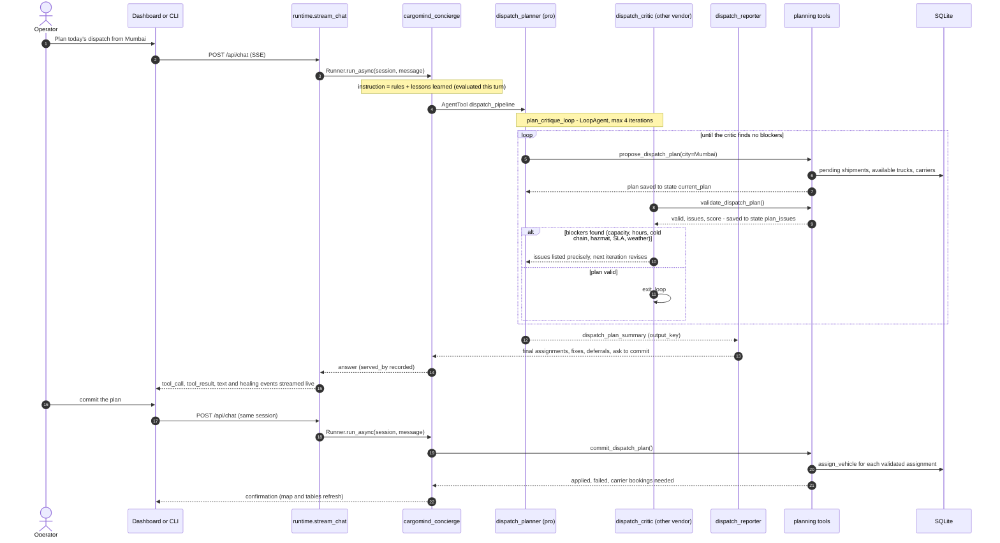
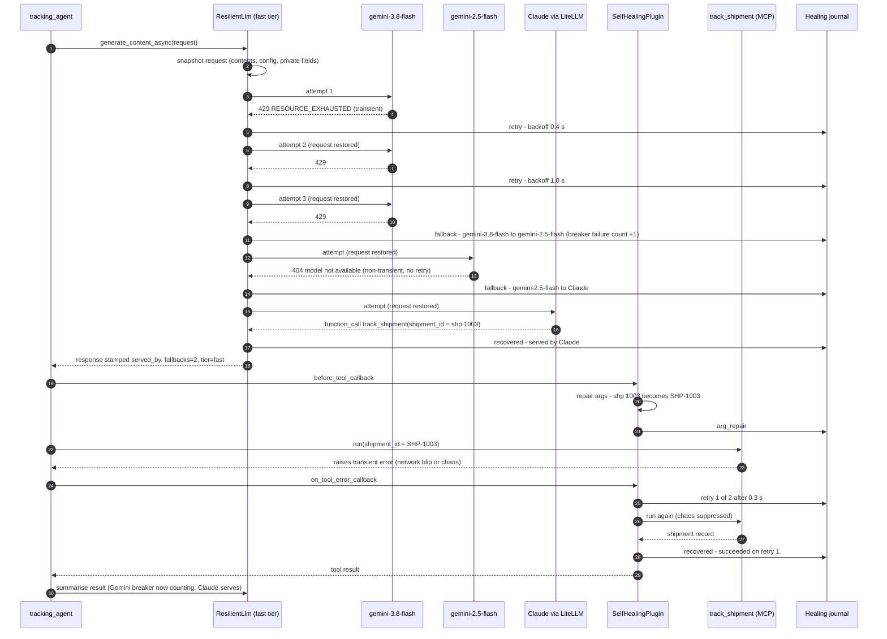
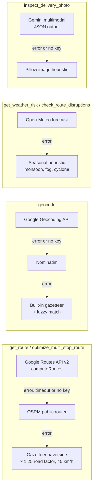
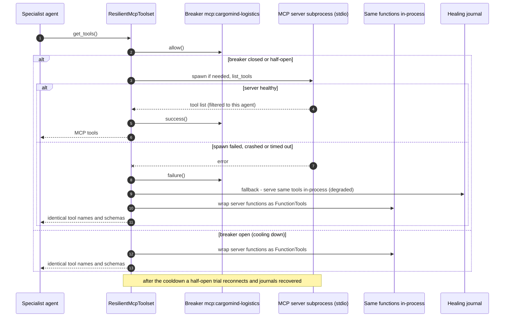
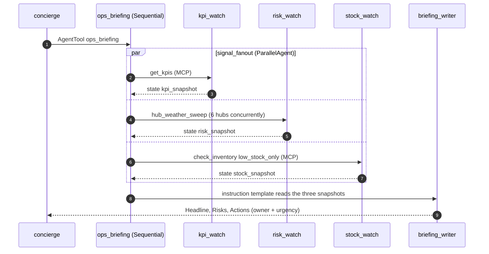
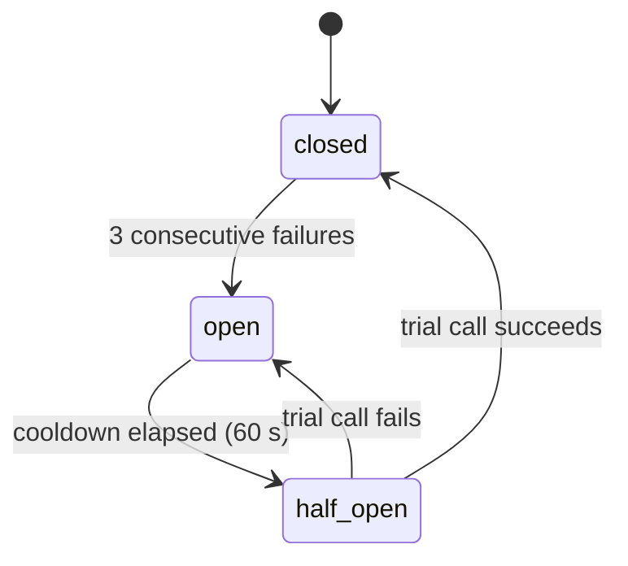

# CargoMind architecture

This document goes one level deeper than the [README](../README.md). It covers the design principles, the layers, two end-to-end sequence diagrams (a dispatch request and a self-healing fallback), the MCP failover path, the event stream, the data model and how to extend the system.

- [Design principles](#design-principles)
- [Layers](#layers)
- [Agent inventory and state](#agent-inventory-and-state)
- [Sequence 1: a dispatch request, end to end](#sequence-1-a-dispatch-request-end-to-end)
- [Sequence 2: self-healing fallback](#sequence-2-self-healing-fallback)
- [Sequence 3: MCP failover](#sequence-3-mcp-failover)
- [Sequence 4: ops briefing fan-out](#sequence-4-ops-briefing-fan-out)
- [Circuit breakers](#circuit-breakers)
- [The offline rule-engine](#the-offline-rule-engine)
- [Event stream contract](#event-stream-contract)
- [Data model](#data-model)
- [Security and safety](#security-and-safety)
- [Extending CargoMind](#extending-cargomind)

---

## Design principles

1. **Never go dark.** Every model has a fallback chain that ends in a deterministic engine. Every external API has a fallback provider that ends in an offline estimate. The MCP transport falls back to in-process tools. A fault becomes a journal entry, not an outage.
2. **Tools for facts.** Agents are instructed never to invent shipment data, distances, weather or stock. Every fact comes from a tool, and every tool result says where it came from (`source`) and whether it is approximate (`degraded`).
3. **Fail informatively.** Tools never raise for "not found". They return `{"status": "error", "error": ..., "suggestions": [...]}` so the LLM can correct itself. Tools *do* raise for transient infrastructure failures, so the self-healing layer can retry them.
4. **Humans decide.** Agents propose. Writes that matter (committing a plan, sending a message, raising a PO, changing a status) happen only on an explicit operator instruction.
5. **Everything observable.** Every tool call, model hand-off, retry, fallback and lesson is streamed to the UI and persisted.
6. **Zero-key reproducibility.** The same code path runs with no keys at all (offline engine + free or offline APIs). That makes CI, judging and offline demos reliable.

---

## Layers

| Layer | Modules | Responsibility |
|---|---|---|
| Interfaces | `web/server.py` + `web/static/`, `cli.py`, ADK Dev UI (`adk web src`), external MCP clients | Human and agent entry points |
| Runtime | `runtime.py` | One ADK `Runner` over `App(root_agent, plugins=[SelfHealingPlugin()])`, an in-memory session service, and `stream_chat()`, which merges agent events with live healing events |
| Agents | `agent.py` | 13 `LlmAgent`s + 2 `SequentialAgent`s + 1 `LoopAgent` + 1 `ParallelAgent` |
| Models | `healing/resilient_llm.py`, `healing/offline_llm.py` | Per-agent `ResilientLlm` chain: Gemini → Gemini backup → Claude/GPT (LiteLLM) → `OfflineLlm` |
| Healing | `healing/plugin.py`, `breaker.py`, `chaos.py`, `journal.py`, `mcp_tools.py` | Argument repair, retries, breakers, reflection, fault injection, journal |
| Tools | `tools/geo.py`, `weather.py`, `planning.py`, `vision.py`, `comms.py`, `feedback/store.py`, MCP tools | Domain actions + external API calls with provider fallbacks |
| MCP | `mcp_server/server.py` | `cargomind-logistics` server: 11 tools + 2 resources over stdio |
| Data | `data/db.py`, `data/gazetteer.py` | SQLite (WAL) operational store with a deterministic seed. A 20-city gazetteer with aliases |

---

## Agent inventory and state

| Agent | Type | Model tier | Tools | Writes state |
|---|---|---|---|---|
| `cargomind_concierge` | LlmAgent (root) | fast | 7 × `AgentTool`, `commit_dispatch_plan`, `remember_operator_feedback` | – |
| `tracking_agent` | LlmAgent | fast | MCP `track_shipment`, `list_shipments`, `shipment_history`, `update_shipment_status`. `estimate_eta` | – |
| `route_risk_agent` | LlmAgent | fast | `get_route`, `optimize_multi_stop_route`, `geocode`, `get_weather_risk`, `check_route_disruptions`, `quote_carriers` | – |
| `inventory_agent` | LlmAgent | fast | MCP `check_inventory`, `create_reorder`, `list_warehouses` | – |
| `dispatch_pipeline` | SequentialAgent | – | `plan_critique_loop` → `dispatch_reporter` | – |
| `plan_critique_loop` | LoopAgent (max 4) | – | `dispatch_planner` → `dispatch_critic` | – |
| `dispatch_planner` | LlmAgent | pro | `propose_dispatch_plan` | `current_plan` (tool), `dispatch_plan_summary` (`output_key`) |
| `dispatch_critic` | LlmAgent | critic | `validate_dispatch_plan`, `exit_loop` | `plan_issues` (tool) |
| `dispatch_reporter` | LlmAgent | fast | – | – |
| `comms_agent` | LlmAgent | fast | `draft_customer_notification`, `send_notification`, MCP `track_shipment` | – |
| `vision_inspector` | LlmAgent | vision | `inspect_delivery_photo` | – |
| `ops_briefing` | SequentialAgent | – | `signal_fanout` → `briefing_writer` | – |
| `signal_fanout` | ParallelAgent | – | `kpi_watch`, `risk_watch`, `stock_watch` | – |
| `kpi_watch` / `risk_watch` / `stock_watch` | LlmAgent | fast | MCP `get_kpis` / `hub_weather_sweep` / MCP `check_inventory` | `kpi_snapshot` / `risk_snapshot` / `stock_snapshot` |
| `briefing_writer` | LlmAgent | fast | – (reads `{kpi_snapshot?}`, `{risk_snapshot?}`, `{stock_snapshot?}` from the instruction template) | – |

The concierge's instruction is a **function** (`concierge_instruction(ctx)`), so ADK evaluates it on every turn. That is how `render_lessons_block()` (operator feedback) reaches the model without a restart. `AgentTool` runs each specialist on its own sub-session and propagates state changes back to the parent session. That is how `current_plan` written inside `dispatch_pipeline` is visible to `commit_dispatch_plan`, which the concierge calls turns later.

---

## Sequence 1: a dispatch request, end to end

*"Plan today's dispatch from Mumbai"*, followed later by *"commit the plan"*.

Key points:

- The planner and critic use **different model chains**. The critic tier puts the second vendor (Claude or GPT) first when a key is set, so a plan is never approved by the model family that wrote it.
- The loop's termination is **data-driven**: `validate_dispatch_plan` decides `valid`. The critic's only job is to relay issues precisely or call `exit_loop`.
- `commit_dispatch_plan` refuses an unvalidated revision unless the operator explicitly insists (`force=True`). Carrier hand-offs are returned as booking actions and are never auto-booked.

---

## Sequence 2: self-healing fallback

A tracking question during a Gemini quota spike, with a fumbled ID and a flaky tool call.

What happens when things get worse:

| Situation | Behaviour |
|---|---|
| A model keeps failing | After `CARGOMIND_BREAKER_THRESHOLD` (3) exhausted turns its breaker **opens**, and the chain skips it instantly for `CARGOMIND_BREAKER_COOLDOWN` (60 s). It then gets a half-open trial |
| Every online model fails | `OfflineLlm` (never chaos-injected, never skipped) answers from tool-driven rules. The turn completes |
| Even the offline link raises | `on_model_error_callback` returns a graceful assistant message instead of crashing the run, and journals the failure |
| A tool keeps failing | After retries the plugin returns `{"status": "error", "healing_hint": ..., "transient": true}`. The LLM reflects and picks another approach or asks the user. The tool's breaker opens after repeated failures and short-circuits with a `degraded` response until the cooldown ends |
| The LLM calls a tool that doesn't exist | The plugin returns the error with the list of valid tools so the model corrects itself (`reflect`) |
| An external API fails | The tool moves to the next provider inside itself (see below), journals a `fallback` and flags the result `degraded: true` |

Provider chains inside tools:

Failed providers are put on a short cooldown, and results are cached briefly, so a dead provider isn't hammered on every call.

---

## Sequence 3: MCP failover

Every MCP tool is also a plain module-level function in `mcp_server/server.py`, so the in-process path runs exactly the same code against the same SQLite file. `CARGOMIND_MCP_LOCAL=1` forces the in-process path, for hosts that forbid subprocesses.

---

## Sequence 4: ops briefing fan-out

---

## Circuit breakers

One breaker per component: `model:<id>`, `tool:<name>` and `mcp:cargomind-logistics`. Thresholds come from `config.py`. Every transition is journaled (`breaker_open` / `breaker_close`) and visible in the dashboard and at `GET /api/healing`.

---

## The offline rule-engine

`healing/offline_llm.py` implements ADK's `BaseLlm` protocol without any network. It is the last link of every chain, and the only link in zero-key mode and in CI.

- **Intent → tool.** Each agent has an `OfflinePolicy` of keyword rules, for example `"eta", "late", "sla"` → `estimate_eta`. The concierge uses **router mode** (`multi=True`) and calls every matching specialist in one turn.
- **Arguments from the tool's own schema.** For each declared parameter it extracts the value from the request text. IDs come from regexes (`SHP-1003`, `TRK-101`, `WH-BLR`, `SKU-107`). Cities come from the gazetteer, in order of appearance (origin, destination, stops). It also picks up weights (`800kg`, `2 t`), priority, channel, status, `low_stock_only` and `avoid_tolls`. Values are coerced to the declared types.
- **Chained calls.** Rules can declare follow-ups, for example `track_shipment` → `estimate_eta`.
- **Loop control.** The critic's policy calls `exit_loop` as soon as `validate_dispatch_plan` returns `valid: true`.
- **Writers.** `echo_context` policies compose the briefing or report from sibling agents' outputs.
- **Rendering.** Tool results become markdown (key facts + tables). Each response carries `served_by: offline/rule-engine`.

Because it is deterministic, it doubles as a test oracle. CI runs the complete 8-step demo through it under 30% chaos.

---

## Event stream contract

`runtime.stream_chat(session_id, text, image_ref=None)` yields dicts. The dashboard relays them as SSE `data:` frames on `POST /api/chat`.

| `type` | Fields | Meaning |
|---|---|---|
| `agent` | `author`, `text`, `mode` | Turn started. `mode` = live providers and model ids |
| `tool_call` | `author`, `tool`, `args`, `served_by` | An agent (or the model serving it) called a tool or sub-agent |
| `tool_result` | `author`, `tool`, `result` (truncated) | Tool or sub-agent result |
| `text` | `author`, `text`, `served_by`, `final` | Model text. The concierge's final text is the answer |
| `healing` | `author="self_healing"`, `event` = `{id, ts, kind, component, detail, action, outcome}` | Live journal entry raised during this turn |
| `error` | `author`, `text` | Unrecoverable error (rare: the healing layers absorb most) |
| `done` | `author` | Turn finished |

`GET /api/healing/stream` streams the same `event` objects for all turns, plus keep-alives.

---

## Data model

SQLite at `data/cargomind.db` (WAL mode), created and seeded deterministically (`random.Random(42)`) on first access. Timestamps are shifted forward when the DB is reopened later, so ETAs and promises stay relative to "now".

| Table | Owner | Contents |
|---|---|---|
| `warehouses` | data | 5 DCs (`WH-BOM`, `WH-DEL`, `WH-BLR`, `WH-MAA`, `WH-HYD`): capacity, utilisation, cold chain, manager |
| `inventory` | data | 20 SKUs × warehouses: on-hand, reorder point/qty, unit cost (INR), supplier |
| `vehicles` | data | 10 trucks: type, capacity, status, city, driver, **driver hours today**, fuel, refrigerated |
| `carriers` | data | 5 carriers: modes (road/rail/air), rates, reliability, speed, max weight |
| `shipments` | data | 25 shipments: customer, lane, status, priority, weight, carrier/vehicle, ETA, promised-by, notes, contents |
| `shipment_events` | data | Status history per shipment |
| `purchase_orders` | data | POs raised by `create_reorder` |
| `outbox` | data | Simulated customer messages from `send_notification` |
| `healing_events` | healing | Every journal entry (`kind`, `component`, `detail`, `action`, `outcome`) |
| `feedback` | feedback | Ratings (±1), comments, rated message, agent, session |
| `preferences` | feedback | Lasting operator rules (`operator_rule:*`) and key/value preferences |

---

## Security and safety

- **Secrets.** Keys are read only from the environment or `.env`. `.env` is git-ignored and docker-ignored. Placeholder values are scrubbed so SDKs never send them. Errors are reported without keys (HTTP failures are journaled as status codes). On Cloud Run, `deploy/cloudrun.sh` stores keys in **Secret Manager**.
- **Uploads.** Image type is checked by magic bytes **and** a Pillow `verify()`, with an 8 MB cap. Files are stored under random UUID names, served only through a strict filename regex, and read by the agent only from inside `UPLOAD_DIR`.
- **Side effects are gated.** Commit, send, reorder and status changes require an explicit operator instruction. Messages go to a simulated outbox. Carrier bookings are suggested, never executed.
- **MCP hygiene.** stdout is reserved for JSON-RPC and logs go to stderr. Look-up misses return structured errors, not exceptions.
- **Demo scope.** The dashboard has no authentication. For a shared deployment, drop `--allow-unauthenticated` and put Cloud Run behind IAP or an identity-aware proxy.

---

## Extending CargoMind

**Add a tool**
1. Write a typed function (sync or async) with a Google-style docstring. The docstring *is* the LLM's tool description. Return a JSON-serialisable `dict`, return `{"status": "error", "suggestions": [...]}` for misses, and raise for transient failures.
2. Start it with `maybe_fail("tool:<name>")` so Chaos Monkey can exercise it.
3. Add it to an agent's `tools=[...]` in `agent.py`, and add an `OfflineRule(tool=..., keywords=[...])` so it also works in zero-key mode.
4. To share it with external clients, also register it in `mcp_server/server.py` and request it with `mcp("<name>")`.

**Add a specialist agent**
1. Create an `LlmAgent` with `model=build_model("fast" | "pro" | "vision" | "critic", OfflinePolicy(...))`, an instruction built on `COMMON`, and its tools.
2. Add `AgentTool(agent=...)` to the concierge's tools and a keyword rule to `ROUTER_RULES`.
3. It automatically inherits the resilient model chain, the `SelfHealingPlugin`, journaling and the dashboard trace.
